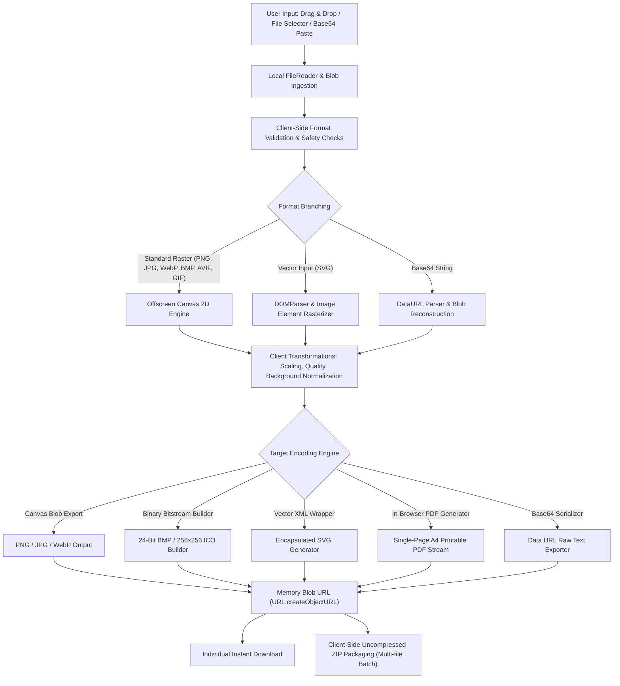

# ⚡ PixelForge — Enterprise Suite of 60 In-Browser Image Converters

<p align="center">
  <strong>Zero Uploads. Zero Cloud Costs. 100% Client-Side Privacy.</strong><br>
  An enterprise-grade, high-performance monorepo suite of 60 standalone, web-based image conversion tools.<br>
  Built and open-sourced with ❤️ by <strong><a href="https://www.spmanchester.com">SPManchester Private Limited</a></strong>.
</p>

<p align="center">
  <a href="https://www.spmanchester.com"></a>
  <a href="mailto:info@spmanchester.com"></a>
  <a href="./LICENSE"></a>
  <a href="https://github.com"></a>
  
  
</p>

---

## 🌟 Executive Summary & Enterprise Value

In traditional web architectures, image conversion services require users to upload sensitive graphic assets to external cloud servers. This approach introduces critical liabilities:

1. **Severe Privacy & Compliance Risks:** Images containing personally identifiable information (PII), proprietary artwork, medical charts, or confidential trade secrets leave the user's perimeter.
2. **Exponential Server Infrastructure Costs:** Server-side CPU transcoding (via ImageMagick, libvips, or Sharp) incurs significant compute bills, API limits, and cloud egress charges.
3. **Network Bottlenecks & Failure Points:** High-resolution file uploads degrade on unstable connections, and third-party API downtimes directly impact operational workflows.

**PixelForge** eliminates these liabilities by offloading 100% of the image decoding, rasterization, color-space mapping, and encoding logic to the client's local browser runtime via **HTML5 Canvas 2D, OffscreenCanvas, Typed Arrays, and Blob Streaming APIs**.

Whether deployed as a unified enterprise internal utility, embedded within client portals, or hosted as 60 standalone micro-sites on static CDNs (GitHub Pages, Vercel, Cloudflare Pages), PixelForge guarantees **zero server data retention, zero bandwidth compute costs, and millisecond-level conversion throughput**.

---

## 🏢 Built by SPManchester Private Limited

PixelForge is conceptualized, architected, and maintained by **[SPManchester Private Limited](https://www.spmanchester.com)** under the technical leadership of **Sayed Mudassar Akbar**. 

At SPManchester, we engineer high-performance bespoke enterprise software, scalable web applications, and security-centric digital transformation platforms. If your organization requires custom media pipelines, enterprise WebAssembly modules, cloud modernization, or secure private software engineering, our team is available for consulting and delivery:

- **Official Website:** [www.spmanchester.com](https://www.spmanchester.com)
- **Corporate Inquiries & Enterprise Support:** [info@spmanchester.com](mailto:info@spmanchester.com)
- **Lead Architect & Author:** Sayed Mudassar Akbar

---

## 📊 Conversion Matrix (60 Independent Format Tools)

PixelForge provides complete bidirectional conversions across the 10 most critical enterprise image and document formats: **PNG, JPG, WebP, SVG, BMP, GIF, ICO, AVIF, PDF, and Base64 Data URLs**.

| Source Format | Target Formats Supported Client-Side |
| :--- | :--- |
| **PNG** | [JPG](./png-to-jpg/) • [WebP](./png-to-webp/) • [BMP](./png-to-bmp/) • [ICO](./png-to-ico/) • [SVG](./png-to-svg/) • [PDF](./png-to-pdf/) • [Base64](./png-to-base64/) |
| **JPG / JPEG** | [PNG](./jpg-to-png/) • [WebP](./jpg-to-webp/) • [BMP](./jpg-to-bmp/) • [ICO](./jpg-to-ico/) • [SVG](./jpg-to-svg/) • [PDF](./jpg-to-pdf/) • [Base64](./jpg-to-base64/) |
| **WebP** | [PNG](./webp-to-png/) • [JPG](./webp-to-jpg/) • [BMP](./webp-to-bmp/) • [ICO](./webp-to-ico/) • [SVG](./webp-to-svg/) • [PDF](./webp-to-pdf/) • [Base64](./webp-to-base64/) |
| **SVG** | [PNG](./svg-to-png/) • [JPG](./svg-to-jpg/) • [WebP](./svg-to-webp/) • [BMP](./svg-to-bmp/) • [ICO](./svg-to-ico/) • [PDF](./svg-to-pdf/) • [Base64](./svg-to-base64/) |
| **BMP** | [PNG](./bmp-to-png/) • [JPG](./bmp-to-jpg/) • [WebP](./bmp-to-webp/) • [ICO](./bmp-to-ico/) • [SVG](./bmp-to-svg/) • [PDF](./bmp-to-pdf/) • [Base64](./bmp-to-base64/) |
| **GIF** | [PNG](./gif-to-png/) • [JPG](./gif-to-jpg/) • [WebP](./gif-to-webp/) • [BMP](./gif-to-bmp/) • [ICO](./gif-to-ico/) • [SVG](./gif-to-svg/) • [PDF](./gif-to-pdf/) • [Base64](./gif-to-base64/) |
| **ICO** | [PNG](./ico-to-png/) • [JPG](./ico-to-jpg/) • [WebP](./ico-to-webp/) • [BMP](./ico-to-bmp/) • [SVG](./ico-to-svg/) • [PDF](./ico-to-pdf/) • [Base64](./ico-to-base64/) |
| **AVIF** | [PNG](./avif-to-png/) • [JPG](./avif-to-jpg/) • [WebP](./avif-to-webp/) • [BMP](./avif-to-bmp/) • [ICO](./avif-to-ico/) • [SVG](./avif-to-svg/) • [PDF](./avif-to-pdf/) • [Base64](./avif-to-base64/) |
| **Base64** | [PNG](./base64-to-png/) • [JPG](./base64-to-jpg/) |

---

## 🏗️ System Architecture & Client Pipeline

PixelForge operates entirely within the browser's sandbox. The diagram below illustrates how an asset travels from input ingestion to downloadable binary without a single byte ever hitting a remote server:



---

## 🚀 Key Features

- 🔒 **Zero Data Transmission (GDPR / HIPAA Friendly):** Files are decoded and encoded directly within the client's browser memory. Zero external HTTP POST calls. Zero tracking.
- ⚡ **Zero Cloud Ingestion Latency:** Conversions begin immediately upon file drop. No queuing, rate-limiting, or upload delays.
- 📦 **Bulk Batch Processing & ZIP Packaging:** Drag and drop dozens of files simultaneously; batch convert and package the outputs into an uncompressed `.zip` archive entirely in memory.
- 🎛️ **Granular Quality & Dimension Control:** Interactive controls for output quality (40%–100%), scaling options (Original, 75%, 50%, 25%), and custom width constraints.
- 💎 **Modern Dark UI Design System:** Clean, responsive glassmorphism UI with ambient glow accents, mobile-friendly layouts, and accessible keyboard controls.
- 🌐 **Static & Zero-Dependency Runtime:** No Node.js runtime, Python backend, database, or cloud storage required. Runs effortlessly from any static web server or CDN.
- 🐳 **Enterprise Container Ready:** Includes production-hardened `Dockerfile`, `docker-compose.yml`, and security-configured `nginx.conf`.

---

## 🛠️ Tech Stack & Technical Specifications

| Layer | Technologies & APIs Utilized |
| :--- | :--- |
| **Core Engine** | HTML5 Canvas 2D API, `OffscreenCanvas`, `FileReader`, `Blob`, `URL.createObjectURL()` |
| **Logic & Scripting** | Vanilla ES6+ JavaScript (Strict Mode, Zero External Runtime Dependencies) |
| **Design & Layout** | Modern CSS3 (CSS Custom Properties, Flexbox, CSS Grid, Media Queries, Backdrop Blur) |
| **Typography & Icons** | System UI Font Stack (Zero external font blocking), Scalable SVG Icons |
| **Packaging & Export** | Custom Client-Side Binary ZIP Serializer, Base64 Streamers, PDF Spec Generators |
| **Container & Hosting** | Nginx Alpine, Docker, Docker Compose, GitHub Pages Actions |

---

## ⚡ Quick Start & Deployment Guide

### Prerequisites
PixelForge is 100% static. You only need a modern web browser or any HTTP static file server.

### 1. Clone the Repository
```bash
git clone https://github.com/serviceprovidermanchester/PixelForge-Image-Converters.git
cd PixelForge-Image-Converters
```

### 2. Local Development Server

#### Option A: Node.js (via `npx serve`)
```bash
# Using npm scripts
npm install
npm start
# Server runs on http://localhost:3000
```

#### Option B: Python 3
```bash
python -m http.server 8080
# Open http://localhost:8080 in your browser
```

#### Option C: VS Code Live Server
Right-click on `index.html` and select **"Open with Live Server"**.

---

### 3. Enterprise Docker Deployment

To run PixelForge as a containerized, self-hosted service within your enterprise network:

```bash
# Build and run with Docker Compose
docker compose up -d

# Or run directly via Docker CLI
docker build -t spmanchester/pixelforge:latest .
docker run -d -p 8080:80 --name pixelforge spmanchester/pixelforge:latest
```
Access the application at `http://localhost:8080`.

---

### 4. Deploying to GitHub Pages (One-Click)

1. Fork or push this repository to your GitHub account under your organization.
2. Navigate to **Settings** → **Pages**.
3. Under **Build and deployment**:
   - **Source:** Choose `Deploy from a branch`.
   - **Branch:** Select `main` and folder `/(root)`.
4. Click **Save**. Your converter suite will be live worldwide on GitHub Pages in seconds!

*(Alternatively, use the included GitHub Actions workflow in [`.github/workflows/deploy.yml`](./.github/workflows/deploy.yml) for automated continuous deployment).*

---

## 📂 Repository Structure

```text
PixelForge_60_Image_Converters/
├── .github/
│   ├── ISSUE_TEMPLATE/
│   │   ├── bug_report.yml          # Structured bug reporting template
│   │   ├── feature_request.yml     # Format request & enhancement template
│   │   └── config.yml              # GitHub issues community configuration
│   ├── workflows/
│   │   ├── ci.yml                  # Syntax, link & integrity testing CI
│   │   └── deploy.yml              # GitHub Pages continuous deployment
│   └── pull_request_template.md    # Pull Request checklist & standards
├── avif-to-png/                    # Standalone AVIF → PNG converter
├── bmp-to-jpg/                     # Standalone BMP → JPG converter
├── png-to-webp/                    # Standalone PNG → WebP converter
├── ... (60 standalone tools)       # All 60 format conversion directories
├── index.html                      # Enterprise Directory Portal & Live Search Hub
├── favicon.svg                     # PixelForge Brand Vector Icon
├── manifest.json                   # Machine-readable registry of all 60 tools
├── manifest.csv                    # Tabular index of all format slugs
├── Dockerfile                      # Production Nginx Alpine container
├── docker-compose.yml              # Container orchestration configuration
├── nginx.conf                      # Optimized caching & security headers config
├── package.json                    # Project metadata & local dev scripts
├── .gitignore                      # Git exclusion rules
├── .env.example                    # Sample environment configuration
├── LICENSE                         # MIT License assigned to SPManchester Private Limited
├── CONTRIBUTING.md                 # Code conventions & contributor guide
├── CODE_OF_CONDUCT.md              # Contributor Covenant Community Standards
├── SECURITY.md                     # Vulnerability disclosure & SLA policy
├── SUPPORT.md                      # Enterprise support & contact guidance
└── README.md                       # Repository master documentation
```

---

## ⚖️ Performance & Privacy Comparison

| Metric / Feature | Cloud-Based SaaS Converters | PixelForge by SPManchester |
| :--- | :--- | :--- |
| **Image Privacy** | Uploaded to third-party cloud servers | **100% In-Browser Local Memory** |
| **Server Bandwidth Cost** | Heavy (Gigabytes/month) | **Zero (Static Delivery)** |
| **Conversion Speed** | Dependent on upload/download speed | **Instant Local CPU / GPU Rendering** |
| **Offline Capability** | ❌ Fails without active internet | **✅ Fully operational offline once loaded** |
| **Batch Limits** | Often restricted behind paywalls | **Unlimited Local Processing** |
| **Data Retention Risk** | Potential data breaches / storage logs | **Zero Bytes Ever Stored Remotely** |

---

## 🗺️ Engineering Roadmap

- [x] Initial release of 60 bidirectional client-side format converters.
- [x] Unified corporate branding under **SPManchester Private Limited**.
- [x] Searchable, responsive hub portal with instant client-side filtering.
- [x] Enterprise Docker & Nginx production containerization.
- [ ] **WebAssembly (WASM) Engine:** Integration of Rust/C++ compiled WebAssembly codecs for multi-threaded AVIF encoding and animated GIF support.
- [ ] **PWA (Progressive Web App):** Offline Service Worker caching for seamless desktop and mobile offline installation.
- [ ] **Vectorization Engine:** In-browser Potrace/WASM bitmap-to-vector path tracing for true raster-to-SVG conversion.
- [ ] **Lossless Palette Optimization:** In-browser pngquant and mozjpeg WASM compression algorithms.

---

## 🤝 Contributing & Community Standards

We welcome contributions from software architects, open-source engineers, and developers worldwide!

Please review our:
- **[CONTRIBUTING.md](./CONTRIBUTING.md)** for our Git commit guidelines, branch workflows, and PR standards.
- **[CODE_OF_CONDUCT.md](./CODE_OF_CONDUCT.md)** for community etiquette.
- **[SECURITY.md](./SECURITY.md)** to responsibly report vulnerabilities.

To propose a new format or fix an edge case:
1. Fork the repository.
2. Create a feature branch: `git checkout -b feat/enhance-avif-decoder`.
3. Commit your changes: `git commit -m 'feat: optimize avif offscreen canvas decoding'`.
4. Push to the branch: `git push origin feat/enhance-avif-decoder`.
5. Open a Pull Request.

---

## 🏢 About SPManchester Private Limited

**SPManchester Private Limited** is an innovative software engineering firm delivering resilient, enterprise-grade cloud platforms, bespoke SaaS applications, and secure digital infrastructure for clients globally.

- 🌐 **Company Website:** [https://www.spmanchester.com](https://www.spmanchester.com)
- ✉️ **General & Business Inquiries:** [info@spmanchester.com](mailto:info@spmanchester.com)
- 👨‍💻 **Technical Leadership:** Sayed Mudassar Akbar
- 💼 **Services:** Enterprise Custom Software Development, Cloud Architecture, DevOps & SRE, Media Processing Solutions, and High-Performance Web Applications.

---

## 📜 License & Copyright

Released under the **[MIT License](./LICENSE)**.

```text
Copyright (c) 2026 SPManchester Private Limited
Author: Sayed Mudassar Akbar
Official Website: https://www.spmanchester.com
Contact: info@spmanchester.com
```

Permission is hereby granted, free of charge, to any person obtaining a copy of this software and associated documentation files, to deal in the Software without restriction. See [`LICENSE`](./LICENSE) for full details.

---

<p align="center">
  <sub>Built with precision, security, and pride by <strong><a href="https://www.spmanchester.com">SPManchester Private Limited</a></strong>.</sub>
</p>
